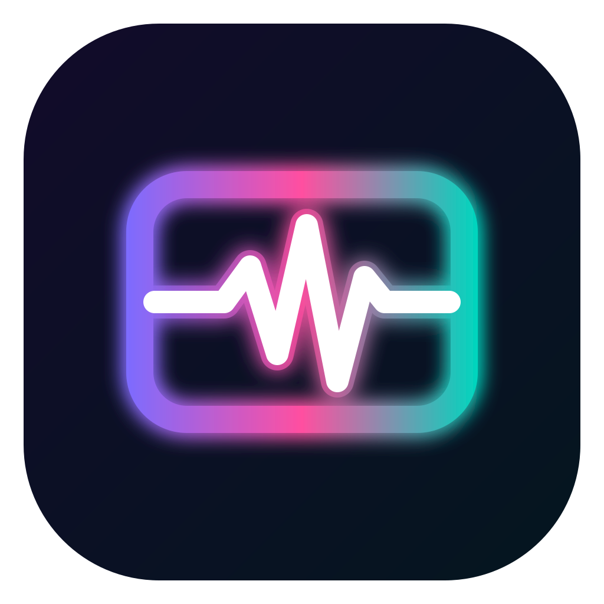
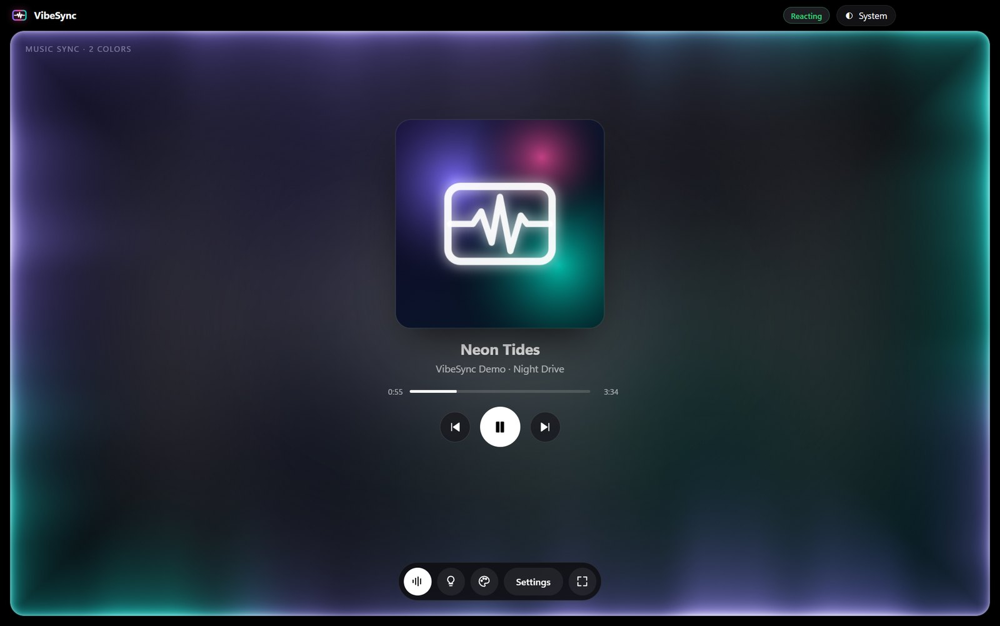
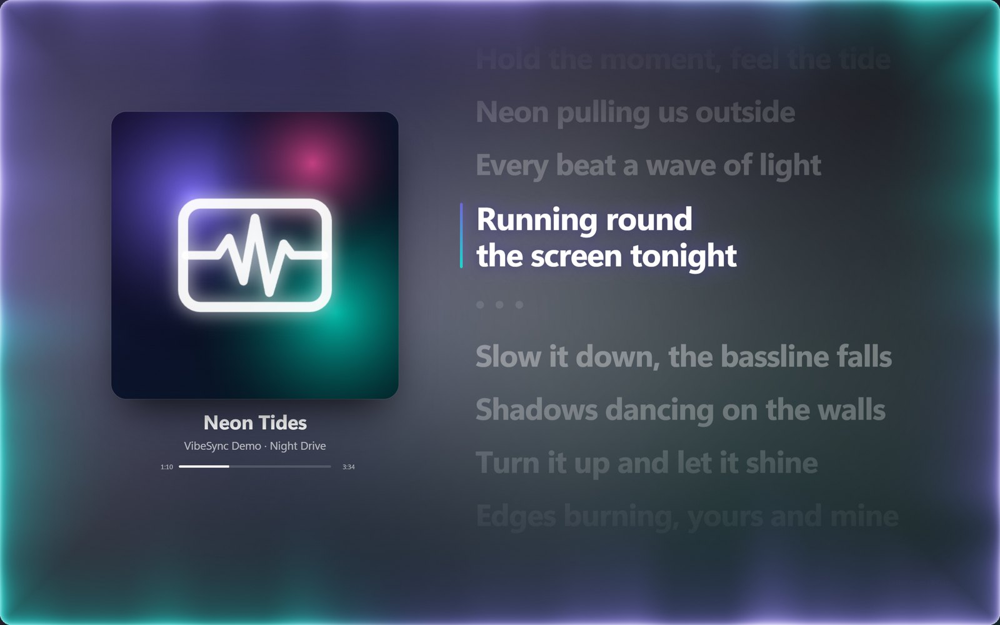
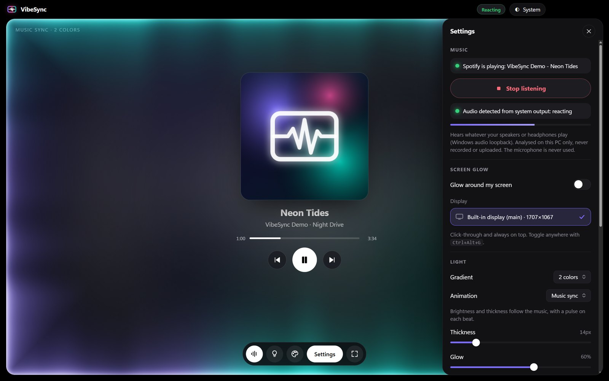
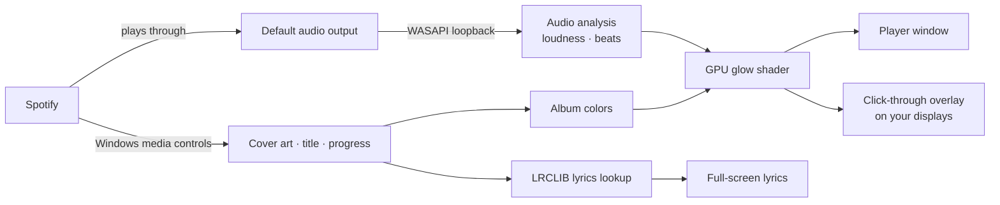

<div align="center">



# VibeSync

<sub>formerly <b>Glowline</b></sub>

**Ambient light for your screen that moves with your music.**

VibeSync turns the edges of your Windows display into soft, living light that pulses with whatever Spotify is playing,<br>
and shows the song's cover art and time-synced lyrics in a full-screen view.

[](LICENSE)


[](https://github.com/dhirenv-21/vibesync/actions/workflows/ci.yml)


[**Download for Windows**](https://github.com/dhirenv-21/vibesync/releases/latest) · [Features](#features) · [How it works](#how-it-works) · [Build from source](#build-from-source) · [Full docs](vibesync/README.md)



</div>

## Features

| | |
| --- | --- |
| 🎵 **Reacts to Spotify** | Listens to your PC's audio output (Windows loopback) and detects loudness and beats locally. No Spotify account, API key or microphone. |
| 💡 **Light around your screen** | A transparent, click-through, always-on-top glow on the displays you choose. A white-hot edge, a colored bloom and a soft fade, drawn on the GPU. |
| 🌊 **Beat waves** | Every kick sends a wave of light racing around the edges. Colors drift and breathe; nothing looks mechanical. |
| 🎨 **Colors from the album** | The glow picks up each cover's colors automatically, or you choose: presets, two color wheels, a solid or two-tone gradient. |
| 🎤 **Full-screen lyrics** | Time-synced lyrics with a glowing current line, smooth scrolling and a drifting cover-art backdrop. |
| ⏯️ **Player controls** | Cover art, title, artist, progress and previous / play-pause / next, straight from Windows' media controls. |
| ⚡ **Light on resources** | 150+ fps on a laptop, no stutter. Only the pixels near the edge are drawn. |
| ♿ **Accessible** | Keyboard operable, labeled controls, visible focus, and respects Windows' *reduce animations* setting. |

<table>
  <tr>
    <td width="50%"><p align="center"><sub>Full-screen lyrics</sub></p></td>
    <td width="50%"><p align="center"><sub>Settings</sub></p></td>
  </tr>
</table>

## Install

1. Download **`VibeSync-Setup-x.y.z.exe`** from the [latest release](https://github.com/dhirenv-21/vibesync/releases/latest).
2. *(Recommended)* Check the download: `Get-FileHash .\VibeSync-Setup-x.y.z.exe -Algorithm SHA256` in PowerShell should match the **SHA-256** in the release notes.
3. Run it. The installer isn't code-signed yet, so Windows SmartScreen may say *"Windows protected your PC"*: click **More info → Run anyway**.
4. Open **VibeSync** from the Start menu, play something in Spotify, and press the **waveform** button. Press the **bulb** to light up your screen.

**Updating:** there's no auto-update yet. Download the newer installer and run it over the old one; your settings are kept. See [docs/RELEASES.md](docs/RELEASES.md) for verification, updating, and the plan for code signing and automatic updates.

**Requirements:** Windows 10 (2004+) or Windows 11, 64-bit, and the Spotify desktop app (any other player works for the light; cover art and controls come from Windows' media controls).

### Quick keys

| Action | How |
| --- | --- |
| Glow on/off from anywhere | <kbd>Ctrl</kbd> + <kbd>Alt</kbd> + <kbd>G</kbd> |
| Full-screen lyrics | Corners button in the toolbar, <kbd>Esc</kbd> to exit |
| Close settings | <kbd>Esc</kbd> |

## How it works



- **Audio:** Electron's display-media handler requests Windows **WASAPI loopback**: what your speakers play, analysed with the Web Audio API for loudness (with auto-gain), bass-band beats and an "audio detected" signal.
- **Now playing:** a small PowerShell helper reads Windows' **Global System Media Transport Controls**, the same source as the volume flyout, for the cover, title, artist, progress and playback commands.
- **Light:** a WebGL fragment shader computes each pixel's distance to the edge and its position around the perimeter, then layers a hot core, bloom and ambient fade with flowing colors and beat waves.
- **Lyrics:** looked up on [LRCLIB](https://lrclib.net) (free, open, no key) and cached locally.

More detail in the [full documentation](vibesync/README.md).

## Privacy

- Audio is analysed **in memory on your PC**. It's never recorded, saved or uploaded.
- The **microphone is never used**; the app denies microphone permission outright.
- **No accounts, no analytics, no telemetry.**
- The only network request is the lyrics lookup, which sends a song's **title, artist, album and length** to lrclib.net. By default VibeSync **asks first** for each new song; choose *Ask each time*, *Always* or *Off* in *Settings → More → Lyrics lookup*.

## Limitations

- **Windows only** for system-audio capture; the overlay itself also runs on macOS/Linux, but music reaction there needs a local audio file.
- Loopback hears **everything** on the default output device, not just Spotify. Pause other audio for the cleanest reaction.
- The glow can't appear over exclusive-fullscreen games, the lock screen or Windows security prompts, and it doesn't control monitor hardware or RGB lighting.
- Lyrics depend on LRCLIB's catalog; very new or niche songs may have none.

## Build from source

```bash
git clone https://github.com/dhirenv-21/vibesync.git
cd vibesync/vibesync
npm install
npm start            # run the app
npm test             # unit tests
npm run demo         # demo track, no Spotify needed
npm run dist         # build the Windows installer into dist/
```

Requires Node.js 20+. See the [full documentation](vibesync/README.md) for configuration, the self-test (`npm run selftest`) and troubleshooting.

### Project structure

```
vibesync/
├─ electron/     main process: windows, loopback capture, overlay, media helper, lyrics
├─ src/          renderer: player UI, GPU glow shader, audio analysis, color logic
├─ tests/        node:test suites (no network, no hardware needed)
├─ build/        app icon and its generator
└─ index.html, overlay.html, styles.css
docs/            screenshots and icon used by this README
```

## Contributing

Issues and pull requests are welcome. See [CONTRIBUTING.md](CONTRIBUTING.md).

## License

[MIT](LICENSE) © 2026 Dhiren Vasudeva

VibeSync is an independent project. Spotify is a trademark of Spotify AB; VibeSync isn't affiliated with or endorsed by Spotify and doesn't use its API. Lyrics are provided by [LRCLIB](https://lrclib.net).
